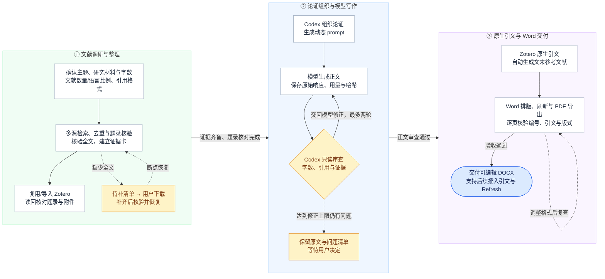

# Zotero-Deepseek-Review Skill

一个供 Codex 使用的中文相关工作/文献综述的Skill。整体工作流是先确认需求，再检索和核验文献、补充全文、整理 Zotero，随后把证据和论证结构交给写作模型，最终生成保留 Zotero 原生引文的 `.docx`。

Skill 名称为 **`zotero-deepseek-review`**。默认使用 **CSTCloud（中国科技云）/ `deepseek-v4-flash`** 进行综述/相关工作的写作，也支持其他渠道和模型的 **OpenAI 兼容 Chat Completions 接口**。渠道切换按任务设置，不会改动其他任务的默认值。

使用Deepseek负责写作工作的原因主要是，GPT在阅读文献和行文逻辑编排上的能力是不错的，但写作能力实在太差，尤其是经常出现防御性表述和不说人话、简单问题复杂化，因此不如直接把单独的写作工作交给中文写作能力还不错的Deepseek进行……

## 工作流



Codex 负责文献检索、著录项内容与格式检查和文档生成；论文正文及内容修正交给其他模型。每轮保留提示词、请求、原始响应、正文、用量，默认最多两轮内容修正。用户后续可在 Word 中通过 Zotero **Add/Edit Citation** 继续插入，**Refresh** 统一更新编号与文末列表。

## 环境与依赖

| 组件 | 要求与验证范围 |
| --- | --- |
|  |
| Zotero Desktop | **已验证 9.0.6**；桥接清单声明 `9.0.6-9.0.*`，其他版本需单独兼容验证 |
| Microsoft Word | **已验证桌面版 Word 16（Windows COM）**；需要正常激活且能保存、导出 PDF |
| Python | 3.10+；运行脚本与测试只使用标准库 |
| Node.js | CSL runtime 单元测试需要；缺失时相应测试跳过，CI 提供 Node 22 |
| PDF 转图工具 | 文档验收需要，按 documents skill 的环境选择 Poppler 等工具 |
| 基础 CSL | 在 Zotero 安装所需 GB/T 7714-2015 顺序编码制上标样式或 APA 7，其他样式按用户模板核对 |

### 需要的Zotero插件

1. **Zotero 的 Microsoft Word 插件**：提供 Word 中的 Zotero 功能区和原生引文更新。通常随 Zotero 安装；缺失时在 Zotero 的“设置 → 引用 → 文字处理软件”安装/重新安装 Word 插件。
2. **Codex Literature Bridge 0.2.1**：本仓库提供源码和构建脚本，安装在 Zotero 内，供后台题录操作及原生笔记转引文使用。首次安装/启用由用户在正常对话框中完成。

桥接绑定本机回环接口 `127.0.0.1:23119`。令牌在 Zotero profile 中本机生成；源码、XPI 和任务配置均不携带令牌。`update_url` 是本机占位地址，源码关闭自动后台更新，升级时重新构建并手动安装 XPI。

### Codex 所需 skills

| Skill | 用途/安装来源 |
| --- | --- |
| [zotero-deepseek-review](skills/zotero-deepseek-review/SKILL.md) | 本仓库包含，安装方法见下文 |
| [nature-academic-search](https://github.com/Yuan1z0825/nature-skills/tree/main/skills/nature-academic-search) | 多源检索、去重与引文核验；在使用者自己的 skills 环境中安装可用版本 |
| [zotero:Zotero](https://github.com/openai/plugins/tree/main/plugins/zotero) | 来自 Codex Zotero 插件，处理本机文献库操作 |
| `documents:documents` | Codex 文档能力，负责 Word 制作、渲染及版式检查 |
| [cstcloud-model-api](https://github.com/pmcpm/cstcloud-model-api-skill) | **使用默认 CSTCloud 适配器时需要**，沿用其直连、保护密钥池、模型发现与诊断；其他渠道无需此项 |
| [nature-citation](https://github.com/Yuan1z0825/nature-skills/tree/main/skills/nature-citation) | 仅当用户明确要求 Nature/CNS 来源时使用 |

外部 skills 需要单独安装，或让Codex根据此README文档自己完成安装。默认 CSTCloud 路径需要现有 `cstcloud-model-api/scripts/cstcloud_api.py`；若环境只有普通 API key，也可选择通用接口适配器配置对应渠道。

## 安装

### 直接让Codex 安装

给 Codex 发送以下指令：

```text
帮我安装这个项目的skill：https://github.com/pmcpm/zotero-deepseek-review
```

### 手动安装

先按上表链接安装所需外部 skills，并在 Codex 中安装 Zotero 插件。

在项目根目录运行 PowerShell。下列 `python` 代表当前环境可用的 Python；Codex 使用其 dependency loader 返回的 Python 绝对路径。

```powershell
# 安装个人 skill，默认位置为 $CODEX_HOME/skills 或 ~/.codex/skills
./tools/install-skill.ps1

# 构建 skill、桥接和项目压缩包
python ./tools/build-release.py
```

已有同名 skill 时，安装脚本默认停止；明确更新时运行 `./tools/install-skill.ps1 -Update`，脚本先在 skills 目录外备份原版本。可用 `-SkillsRoot <目录>` 指定位置。

然后在 Zotero 中选择“工具 → 插件 → 齿轮 → 从文件安装插件”，安装 `dist/codex-literature-bridge-0.2.1.xpi`，按提示启用或重启 Zotero。首次安装后让 Codex 执行健康检查，确认 Word 原生集成可用。

```powershell
python ./skills/zotero-deepseek-review/scripts/bridge_client.py health
```

常规运行使用本地 API、任务自有 Word COM 实例和 Zotero 引擎。**全流程禁止 Computer Use、模拟鼠标键盘、SendKeys 和剪贴板接管**。后台路径需要用户处理安装或授权时，明确提示后等待用户正常操作。安装或使用途中可能会弹出Zotero窗口，属于正常现象。

## 开始使用

在 Codex 中调用：

```text
使用 $zotero-deepseek-review，为“我的研究主题”整理文献并撰写中文相关工作。
请先确认缺失要求，再开始调研；写作默认使用 CSTCloud。
```

首次只询问尚未明确的内容：研究范围与材料、正文字数、文献目标数量、中英文比例及严格程度、引用格式（GB/T 7714/APA/其他）、DOI 显示、中文著录项（英文著录项）、时间和来源、Zotero 分类、全文补充目录及 Word 输出路径。

无法获取的全文先寻找出版社、机构库和作者公开版本，仍缺失时给出完整题录、下载链接、建议文件名和补充目录。继续处理其他文献，在依赖这些全文的写作前等待用户补齐。**公开仓库只保存实现；每项论文任务放在仓库外独立目录。**

## 切换模型渠道

| 场景 | 配置示例 |
| --- | --- |
| 默认 CSTCloud，复用本机保护密钥池 | [examples/model-cstcloud.json](examples/model-cstcloud.json) |
| 其他云渠道或兼容网关 | [examples/model-openai-compatible.json](examples/model-openai-compatible.json) |
| 本机提供 `/v1/chat/completions` 的服务 | [examples/model-local.json](examples/model-local.json) |

本项目 [config/project-defaults.json](config/project-defaults.json) 与 skill 初始化默认值均保持 CSTCloud / `deepseek-v4-flash`。旧任务省略 `model_api` 时同样沿用 CSTCloud。已有论文任务不被安装或打包脚本修改。

使用其他渠道时，在任务 `task.json` 指定：

```json
{
  "model": "YOUR_CHAT_MODEL_ID",
  "model_api": {
    "provider": "openai_compatible",
    "base_url": "https://your-gateway.example/v1",
    "api_key_env": "REVIEW_MODEL_API_KEY",
    "discover_models": true,
    "trust_env": false,
    "temperature": 0.3,
    "timeout_seconds": 240,
    "transport_retries": 1
  }
}
```

把 `base_url` 和模型 ID 替换成渠道提供的值。适配器调用 `<base_url>/models` 和 `<base_url>/chat/completions`，密钥仅从指定进程环境变量读取。外部服务使用 HTTPS；回环地址可用 HTTP，本机无鉴权服务可显式设置 `api_key_env: null`。

PowerShell 中可交互设置临时密钥，避免把密钥写进命令历史或仓库：

```powershell
$reviewKey = Read-Host 'API key' -AsSecureString
$env:REVIEW_MODEL_API_KEY = [System.Net.NetworkCredential]::new('', $reviewKey).Password
python ./skills/zotero-deepseek-review/scripts/model_client.py ./examples/model-openai-compatible.json
# 使用完毕移除当前进程环境变量
Remove-Item Env:REVIEW_MODEL_API_KEY
```

命令须在替换示例地址/模型后的副本上执行；该命令仅探测模型列表。后续推理在同一凭据可见的进程环境运行。更改 PowerShell 环境变量不会自动改变已经运行的 Codex 进程环境，需在其运行环境中配置或从相应环境启动。

通用适配器支持关闭模型发现、可省略的 temperature、两种 token 上限字段、渠道扩展参数及可选环境代理。不会自动换模型。使用供应商原生 Anthropic/Gemini 协议或仅 Responses API 的服务时，需要 OpenAI 兼容网关或另行实现适配器。参数与错误恢复详见 [模型渠道说明](skills/zotero-deepseek-review/references/model-providers.md)。

## 参考文献和正文约束

- 文献导入前核对题录，导入后读回作者、题名、期刊、卷期、页码/文章号、DOI 和附件。具体方法、发现定位到全文。
- 引用使用 `[[R001]]` 等稳定 ID 交给模型，交付时转换为真实 `CSL_CITATION` / `ZOTERO_BIBL` 域，编号和文末列表交给 Zotero。
- 默认正式期刊、会议、图书等著录省略普通 HTTP/HTTPS 链接和引用日期；网页、公告、EB/OL 等必要网络资源保留 URL、发布日期和引用日期。**DOI 是独立选项**，原始 Zotero 题录保持完整。
- 双语著录优先使用来源提供的英文题录，核对译写来源；GB/T 与 APA 分别使用对应 CSL 渲染。
- 默认 A4、2.54 cm 页边距、宋体小四正文、黑体标题、1.5 倍行距、首行缩进 2 字符、全文黑色；用户模板优先。连接符统一 ASCII `-`。
- 字数、数量、比例随任务配置；字数默认包含小节标题，排除引文标识及文末参考文献。Codex 审核，模型负责正文修正。

双语英文缓存、DOI/URL 展示规则在后续刷新时依赖桥接继续启用。新增中文条目、修改题录或切换样式后，运行 skill 同步阶段重建对应英文著录缓存。

## 项目结构

```text
skills/zotero-deepseek-review/
  SKILL.md                 工作流入口，支持自动发现和显式调用
  agents/openai.yaml       Codex 展示信息
  scripts/                 证据门槛、模型适配器、桥接、CSL、Word 和审计
  references/              按需读取的流程、数据契约和恢复说明
  assets/zotero-bridge/    Zotero 扩展完整源码和许可证
  tests/                   隔离的单元与协议测试
config/                    项目默认模型配置
examples/                  无密钥的渠道配置示例
tools/                     安装和发布构建脚本
.github/workflows/         自动化回归测试
dist/                      本机构建产物，Git 忽略
```

## 测试与验证范围

```powershell
python -m unittest discover -s ./skills/zotero-deepseek-review/tests -v
python ./tools/build-release.py
```

新接口测试使用本地 HTTP 服务验证实际请求、认证、模型发现、输出参数、错误及留档；无需外部 API key。CI 运行同一回归集并构建发布包，不启动 Word 或 Zotero。完整本机验证及当前新增验证见 [验证记录](skills/zotero-deepseek-review/references/validation.md)。第三方渠道应先进行 `/models` 探测，再以最小真实任务验证它的响应格式。

历史本机验证覆盖 Zotero 9.0.6 / Word 16 的真实原生引文、GB/T 与 APA、DOI/双语矩阵、前插/重复/删除、保存重开、Zotero 重启与 Refresh。
